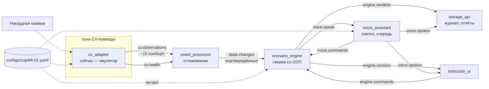

# Архитектура

## Состав

Шесть независимых сервисов, обмен только через шину сообщений. Прямых вызовов
между ними нет — кроме проксирования HTTP в интерфейсе инструктора, и то лишь
для того, чтобы браузер ходил в один порт.

## Принцип разделения

**CV описывает, что видит. Решения принимает движок.**

Поэтому в контракте наблюдения нет ни «шаг выполнен», ни «ошибка оператора» —
только состояние наблюдаемой переменной с уверенностью. Если бы CV присылал
готовые события шагов, он неявно принимал бы решения о безопасности, а
калибровать пороги пришлось бы правками в чужом коде.

## Четыре наблюдаемых переменных на семь шагов

Шаги 3, 4 и 6 — это одна переменная `pipe_position` в трёх разных значениях.
Контракт с CV-командой получается компактным:

| Переменная | Значения | Шаги |
|---|---|---|
| `grounding_lamp` | `off`, `green` | 1 |
| `hatch_cover` | `closed`, `open` | 2 |
| `pipe_position` | `stowed`, `over_hatch`, `seated`, `bottom` | 3, 4, 6 |
| `clamp_weight` | `released`, `pressed` | 5 |

Седьмой шаг — доклад в операторную — камерой не наблюдается в принципе и
закрывается голосовой командой. Это единственное место, где голосовой канал
работает на вход в основной сценарий.

## Сглаживание: почему это отдельный сервис

CV шлёт около пятнадцати сообщений в секунду на переменную, а шаг выполняется
один раз. Между этими двумя темпами и стоит `event_processor`.

Алгоритм — скользящее окно с требованием **согласия**: значение подтверждается,
если внутри окна набралось достаточно наблюдений, доля согласных с ним не ниже
`min_agreement`, а их средняя уверенность не ниже `min_confidence`.

Именно требование согласия гасит дребезг. Пока труба висит на границе между
«над горловиной» и «опущена до упора», каждое из двух значений набирает около
половины окна и ни одно не проходит порог 0.85 — система молчит до тех пор,
пока картинка не устоится. Отдельное «окно отпускания» не нужно: оно только
увеличило бы задержку, ничего не добавив к устойчивости.

Отдельным сервисом это вынесено потому, что здесь алгоритм захочется поменять
первым — и менять его надо будет, не трогая ни CV, ни движок.

## Движок: детерминированный автомат

Никаких вероятностных моделей в тракте принятия решения. Причины:

* **безопасность** — шаг 1 блокирует шаг 2 из-за риска искры, такое решение
  обязано быть воспроизводимым и объяснимым;
* **бюджет задержки** — на сверку отведено 100 мс;
* **измеримость точности** — метрика из п. 6.1.3 ТЗ требует, чтобы один и тот же
  прогон давал один и тот же результат.

Правила движка:

1. **Вердикт выносится на действие, а не на состояние мира.** Рассматриваются
   только шаги, которых касается пришедшее изменение. Иначе смена положения
   трубы заставляла бы переоценивать механизм прижатия и сыпать повторами.
2. **Тяжесть нарушения определяется критичностью пропущенного шага.** Открыть
   люк без заземления — критическая блокировка. Опустить трубу, не подведя её
   над горловиной, — нарушение порядка.
3. **Прежде чем обвинить оператора — проверить состояние мира.** Если условия
   «пропущенного» шага по факту соблюдены, а формально он не закрыт, шаг
   закрывается задним числом. Это наша неуверенность, а не его нарушение.
4. **Порог уверенности откладывает зачёт, а не отменяет его.** В момент
   подтверждения окно ещё содержит кадры самого движения, и уверенность
   занижена; за паузу `low_confidence_grace_sec` она дорастает. Шаг, засчитанный
   с низкой уверенностью, помечается в деталях вердикта.
5. **Инварианты держатся до конца сценария.** Заземление, подключённое на первом
   шаге, не должно пропасть на пятом.

Четыре вида вердикта — `MATCH`, `MISMATCH`, `UNCLEAR`, `TIMEOUT`. Разница между
`MISMATCH` и `UNCLEAR` принципиальна: первое — ошибка оператора, второе — система
не разобрала. Смешивать их нельзя, иначе метрика точности теряет смысл.

## Голос: очередь с прерыванием

Реплики не должны накладываться, поэтому очередь выдерживает паузу на время
звучания. Но норматив п. 6.2 ТЗ отсчитывается от завершения действия до **начала**
обратной связи — значит реакция на действие не имеет права стоять в очереди.

Правило: подтверждение, предупреждение и критическое сообщение идут вперёд
очереди и **обрывают инструкцию**, если та ещё звучит. Инструкция, которую
оператор уже выполнил, не просто бесполезна — она мешает услышать оценку
сделанного. Без этого правила сквозная задержка на измерениях составляла
7,6 с при исправной во всём остальном системе.

Постоянные фразы СОП синтезируются при старте (прогрев кэша), иначе первая
реплика оплачивала бы загрузку модели из бюджета задержки.

## Бюджет задержки

Норматив 2 секунды из п. 6.2 ТЗ разделён по звеньям **заранее**, чтобы на
приёмке не выяснять, из-за чьей части не уложились.

| Звено | Бюджет | Кто отвечает |
|---|---|---|
| Захват кадра, инференс, публикация | 500 мс | CV-команда |
| Окно подтверждения состояния | 1100 мс | сценарная часть |
| Сверка со СОП, вердикт | 100 мс | сценарная часть |
| От вердикта до начала реплики | 300 мс | сценарная часть |
| **Итого** | **2000 мс** | |

Окно сглаживания вынесено отдельной строкой сознательно: это самая крупная
статья расхода во всём тракте, и принадлежит она сценарной части, а не CV.
Ужимать её имеет смысл только вместе с ростом качества распознавания — иначе
посыплются ложные срабатывания.

Измеренное на приёмочных прогонах: максимум **1067 мс** от действия до вердикта,
**1050 мс** от действия до начала реплики на живом стенде.

## Две сборки, один код

| | `python run_local.py` | `docker compose up` |
|---|---|---|
| Процессы | один | семь |
| Шина | `InMemoryBus` (asyncio-очереди) | `RedisStreamBus` |
| HTTP | один порт | по порту на сервис, UI проксирует |
| Назначение | разработка, машина без Docker | поставка |

Различается только точка сборки и реализация шины за интерфейсом `Bus`. Сами
сервисы про это не знают. Ради этого абстракция шины и заведена — она же
требуется п. 1.1 вопросника Заказчика.

Порядок старта имеет значение: потребители подписываются раньше, чем источник
начинает публиковать. В `run_local.py` `cv_adapter` стартует последним, в
compose — через `depends_on`.

## Где проходит граница LLM

Языковая модель в тракте вынесения вердикта не используется и не должна.
Место для неё — объяснение и формулировка, но не решение:

* формулировка реплик — интерфейс `Responder`, сейчас шаблоны из YAML;
* итоговый разбор сеанса после завершения тренировки;
* RAG по регламентам для ответа на «почему нужно заземление»;
* автопарсер PDF регламента в YAML-СОП — офлайн-инструмент.

Граница одна: **LLM объясняет и формулирует, но не выносит вердикт.**
